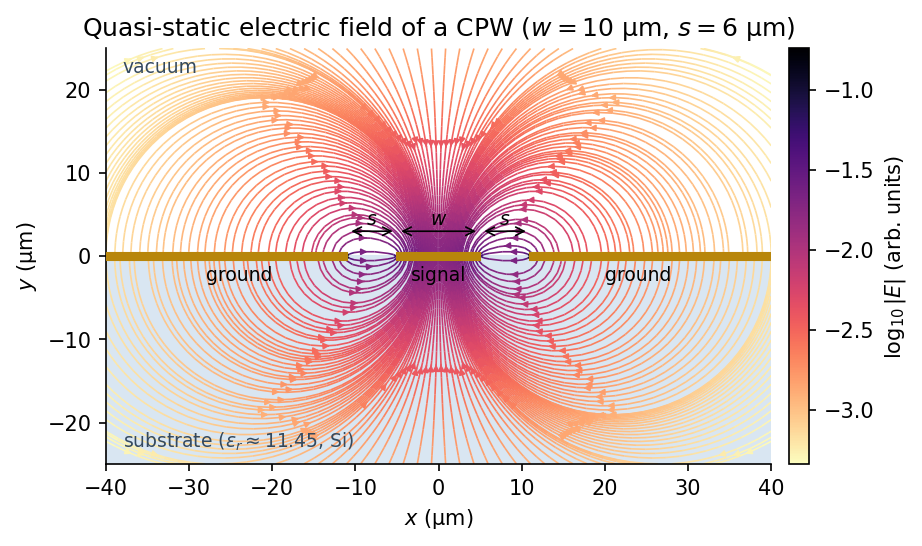
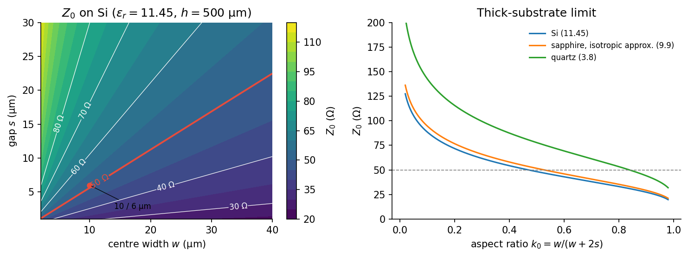

# CPW Fundamentals

**Part 1 of 3** · [Project overview](../README.md) · Next: [Transmission Line Theory →](02_transmission_line_theory.md)

## Introduction and motivation

A coplanar waveguide (CPW) is a planar transmission line in which a center conductor and two return conductors (ground planes) lie on the same face of a dielectric substrate, separated by two narrow slots [1]. A microwave signal propagates along the line as an electromagnetic wave guided by the voltage between the center strip and the grounds and by the currents flowing on them.

CPW is widely used in microwave integrated circuits because the signal and return conductors are on the same side of the chip. This has several practical consequences:

- **Single-layer fabrication.** A basic CPW needs one patterned metal film. It needs no vias and no backside ground plane.
- **Easy access to ground.** Shunt elements, probes, and wirebonds can connect to ground right next to the signal line.
- **Impedance set by lateral ratios.** The characteristic impedance depends mainly on $w/(w+2s)$, so the same impedance can be kept while the line is scaled up or down (for example, tapering from a wide bond pad to a narrow on-chip line).

In superconducting quantum hardware, CPWs form feedlines, readout and bus resonators, Purcell filters, and flux and drive lines. CPW resonators are also a standard test vehicle for materials: their quality factors are sensitive to the substrate, the metal films, and the thin surface and interface layers where the CPW electric field is concentrated [3–5].

CPW is not the right choice for every application. Microstrip places the signal strip above a ground plane on the opposite side of the substrate and confines more of its field in the dielectric. Stripline encloses the signal between two grounds at the cost of multilayer fabrication. The weaknesses of CPW are its unwanted modes and its exposed fields. It can support a parasitic *slotline* mode when the two grounds are at different potentials. Its fields extend into the space above the chip and reach exposed surfaces. Discontinuities and finite grounds can radiate. These issues are handled in layout (ground stitching, air bridges) and packaging, as discussed below.

## Physical geometry

The idealized CPW cross-section has a center strip of width $w$, two slots of width $s$, and ground planes extending outward on both sides, all patterned on a substrate of thickness $h$. In a *symmetric* CPW the two slots and surrounding materials are mirror-symmetric about the centerline.

```text
Cross-section (not to scale; x transverse, y vertical, z out of the page along the line)

        ground                 signal                 ground
   ━━━━━━━━━━━━━━━━━━┓       ┏━━━━━━━━━┓       ┏━━━━━━━━━━━━━━━━━━   metal, thickness t
                     ┃<─ s ─>┃<── w ──>┃<─ s ─>┃
   ──────────────────────────────────────────────────────────────   substrate surface
                         substrate, εr, thickness h
   ──────────────────────────────────────────────────────────────   (optional backside metal)
```

The cross-section is uniform along the propagation direction $z$. In a real device the ground planes have a finite lateral extent $g$, the metal has a finite thickness $t$, and the substrate may sit on a backside metallization inside a metal package.

| Symbol | Meaning | Typical value in superconducting circuits |
|---|---|---|
| $w$ | center-conductor width | 2–20 µm |
| $s$ | slot (gap) width | 1–12 µm |
| $g$ | lateral width of each ground plane (when finite) | ≫ $w + 2s$ |
| $h$ | substrate thickness | 250–650 µm |
| $t$ | metal film thickness | 50–300 nm |

The *ratios* among these dimensions, rather than any single dimension, set the quasi-static field pattern. The key ratio is the aspect ratio $k_0 = w/(w+2s)$. Changing $w$ relative to $s$ changes both the electric-field distribution and how the return current divides between the two grounds. Wide grounds make the cross-section approach the idealized infinite-ground model. The substrate thickness matters only when the fields reach the backside, which for $h \gg w + 2s$ they barely do.

## Electromagnetic field distribution

In the fundamental (even, or "CPW") mode, the center conductor carries the signal current and the two grounds share the return current equally. The center strip and grounds are at different potentials, so the slots carry a strong transverse electric field. The field is especially concentrated at the metal edges. For an idealized infinitely thin, perfectly sharp conductor, the field diverges as $r^{-1/2}$ at the edge. Finite thickness, edge rounding, and microscopic roughness keep it finite in practice, but the field near the edges remains much stronger than in the bulk of the slot.

The magnetic field circulates around the center-strip current and closes through the return currents on the grounds. These currents also crowd toward the edges facing the slots. As a result, conductor loss and kinetic inductance are both sensitive to the quality of the edges.



*Figure 1. Electric field lines of a zero-thickness CPW with infinite grounds ($w = 10$ µm, $s = 6$ µm), computed analytically from the conformal-mapping solution. Color shows the field magnitude on a log scale. Field lines start on the signal conductor and end on the grounds. The field is strongest in the slots and at the metal edges. For an infinitely thick substrate the field pattern is the same above and below the metal plane; only the stored energy differs. Generated by [`scripts/generate_doc_figures.py`](../scripts/generate_doc_figures.py).*

The fields are not confined to the substrate. Field lines pass through both the substrate and the space above it (vacuum in a cryogenic package). Figure 1 shows a useful consequence of the zero-thickness geometry on a thick substrate: the field *pattern* in the two half-spaces is identical, so the substrate fills exactly half of the field space. This is why the effective permittivity introduced below reduces to $(\varepsilon_r + 1)/2$ in that limit.

Because the field is concentrated at the edges, the thin layers near the metal (native oxides, residues, the metal–substrate interface) can store a meaningful fraction of the electric energy even though their volume is tiny. This *surface participation* is the main reason the CPW geometry influences dielectric loss in superconducting resonators [4, 5].

## Quasi-TEM propagation

In an exact **TEM** (transverse electromagnetic) wave, both the electric and magnetic fields are entirely transverse to the direction of propagation. A two-conductor line embedded in a *single homogeneous* dielectric supports such a mode. A CPW on a substrate does not: its fields straddle two dielectrics (substrate and vacuum), so the transverse cross-section is inhomogeneous. Boundary conditions at the dielectric interface then require small longitudinal field components.

At frequencies where the cross-section is small compared with the wavelength, these longitudinal components are small and the mode is well described as **quasi-TEM**. For the 4–8 GHz range used in superconducting circuits, $w + 2s \sim 20$ µm, whereas the guided wavelength is ~2 cm, so the approximation is excellent. The cross-section can then be solved as a 2D electrostatics problem, and the dielectric loading is summarized by an **effective relative permittivity** $\varepsilon_\mathrm{eff}$:

$$
v_\mathrm{p} \approx \frac{c}{\sqrt{\varepsilon_\mathrm{eff}}},
\qquad
\beta \approx \frac{\omega}{c}\sqrt{\varepsilon_\mathrm{eff}},
\qquad
\lambda \approx \frac{c}{f\sqrt{\varepsilon_\mathrm{eff}}},
$$

where $v_\mathrm{p}$ is the phase velocity, $\beta$ the phase constant, $c$ the speed of light in vacuum, and $\omega = 2\pi f$. $\varepsilon_\mathrm{eff}$ is the permittivity of a uniform medium that would give the same capacitance per unit length as the real, mixed dielectric. For a simple isotropic substrate with vacuum above, it lies between 1 and $\varepsilon_r$. This bound does not carry over automatically to multilayer, anisotropic, or strongly dispersive stacks.

The quasi-TEM picture is what allows the CPW to be described by a transmission-line model: a voltage and current on the conductors, with distributed inductance and capacitance per unit length. That model is developed in [Transmission Line Theory](02_transmission_line_theory.md).

## Quasi-static design equations

For a CPW with zero-thickness conductors and infinitely wide grounds, conformal mapping gives closed-form expressions for $\varepsilon_\mathrm{eff}$ and the characteristic impedance $Z_0$ [6, 7]. Define

$$
k_0 = \frac{w}{w + 2s},
\qquad
k_0' = \sqrt{1 - k_0^2},
$$

and let $K(k)$ be the complete elliptic integral of the first kind. Then

$$
Z_0 = \frac{30\pi}{\sqrt{\varepsilon_\mathrm{eff}}}\,\frac{K(k_0')}{K(k_0)}\ \ \Omega .
$$

For a substrate much thicker than the slot structure ($h \gg w + 2s$), the substrate fills half the field space, giving

$$
\varepsilon_\mathrm{eff} = \frac{\varepsilon_r + 1}{2}.
$$

For a substrate of finite thickness $h$ (no backside metal), the substrate's contribution is reduced by a filling factor:

$$
\varepsilon_\mathrm{eff} = 1 + \frac{\varepsilon_r - 1}{2}\,
\frac{K(k_1)}{K(k_1')}\,\frac{K(k_0')}{K(k_0)},
\qquad
k_1 = \frac{\sinh\!\left(\pi w / 4h\right)}{\sinh\!\left(\pi (w + 2s)/4h\right)}.
$$

Two consequences are worth remembering:

1. $Z_0$ depends on $w$ and $s$ only through $k_0$, so a 50 Ω line can be scaled to any size by keeping $w/(w+2s)$ fixed. Scaling still changes losses, surface participation, and the risk of unwanted modes.
2. The dielectric only rescales $Z_0$ by $1/\sqrt{\varepsilon_\mathrm{eff}}$. A higher-permittivity substrate needs a smaller $k_0$ (narrower center, wider gaps) to reach the same impedance.



*Figure 2. Left: $Z_0$ as a function of center width and gap on 500 µm silicon. The red curve is the 50 Ω contour. Right: $Z_0$ against aspect ratio in the thick-substrate limit for three substrates. The sapphire curve uses an isotropic approximation $\varepsilon_r \approx 9.9$; sapphire is anisotropic, and its in-plane permittivity depends on crystal cut.*

### Worked example: a 50 Ω line on silicon

Take $w = 10$ µm and $s = 6$ µm on 500 µm high-resistivity silicon ($\varepsilon_r \approx 11.45$ at millikelvin temperatures). The formulas above give:

| Quantity | Value |
|---|---|
| Aspect ratio $k_0$ | 0.455 |
| Effective permittivity $\varepsilon_\mathrm{eff}$ | 6.23 |
| Characteristic impedance $Z_0$ | 50.9 Ω |
| Phase velocity $v_\mathrm{p}$ | $0.401\,c \approx 1.20\times10^{8}$ m/s |
| Inductance per length $L' = Z_0/v_\mathrm{p}$ | 424 nH/m |
| Capacitance per length $C' = 1/(Z_0 v_\mathrm{p})$ | 163 pF/m |
| Guided wavelength at 6 GHz | 20.0 mm |

These are the starting numbers for the resonator design in [CPW Resonators](03_cpw_resonators.md). They neglect conductor thickness (which lowers $Z_0$ slightly by adding sidewall capacitance) and kinetic inductance (which raises $L'$, and with it $Z_0$, while lowering $v_\mathrm{p}$).

## Materials and superconducting implementation

### Substrates

The substrate provides mechanical support and is part of the electromagnetic problem. Its permittivity, loss tangent, anisotropy, thickness, and surface condition all matter.

| Substrate | $\varepsilon_r$ (cryogenic, approx.) | Notes |
|---|---|---|
| High-resistivity Si | 11.45 | Most common; requires high resistivity (≳10 kΩ·cm) so free carriers freeze out. Surface oxide and its removal affect loss. |
| Sapphire (Al₂O₃) | ≈9.3 (⊥ c-axis), ≈11.3 (∥ c-axis) | Very low bulk loss; anisotropic, so effective permittivity depends on crystal cut and line orientation. |
| Quartz (fused silica) | ≈3.8 | Low permittivity; amorphous, so it hosts more two-level-system defects than crystalline substrates. |

The material grade, surface preparation, and fabrication process can matter as much as the choice of material.

### Superconducting films

The patterned metal defines the signal and return paths. Common films:

| Film | $T_c$ (approx.) | Notes |
|---|---|---|
| Aluminum | 1.2 K | Standard for Josephson-junction processes; low kinetic inductance in thick films. |
| Niobium | 9.2 K | Robust and higher $T_c$; its surface oxides can be lossy. |
| Tantalum (α-phase) | 4.4 K | Used for low-loss qubits and resonators; its surface oxide is comparatively benign. |
| TiN, NbTiN | ~4–15 K (stoichiometry dependent) | High kinetic inductance in thin films; used for compact or high-impedance resonators and detectors. |

Below $T_c$, superconductivity eliminates DC resistance, but microwave loss does not vanish. At finite frequency and temperature the film has a complex **surface impedance** $Z_s = R_s + jX_s$. The resistive part $R_s$, which comes from thermal and non-equilibrium quasiparticles, trapped vortices, and other imperfections, causes conductor loss. The reactive part $X_s$ reflects the inertia of the superconducting electrons and appears as **kinetic inductance** $L_k'$, which adds to the geometric (magnetic) inductance per length. Kinetic inductance becomes significant when the film thickness is comparable to or smaller than the London penetration depth (~50–100 nm for Al and Nb, and much larger for disordered films such as TiN). It lowers the phase velocity and the resonance frequency, and it makes them temperature-dependent.

### Loss channels

A CPW resonator's internal quality factor is limited by several distinct loss channels. In the transmission-line model of [Transmission Line Theory](02_transmission_line_theory.md#loss-and-quality-factor) they enter as the series resistance $R'$ (conductor loss) and shunt conductance $G'$ (dielectric loss), or as extra loss terms outside that model:

- **Dielectric loss.** Absorption in the bulk substrate and, usually more importantly, in thin amorphous layers at the metal–air, substrate–air, and metal–substrate interfaces. These layers host **two-level systems (TLS)**, atomic-scale defects that absorb microwave photons. TLS loss saturates at high microwave power and at higher temperature, which gives it a characteristic signature in resonator measurements. Its size is the participation-weighted sum of each region's loss tangent, which is why the edge-concentrated CPW field makes thin surface layers so important.
- **Conductor loss.** Set by the resistive part $R_s$ of the surface impedance: thermal and non-equilibrium quasiparticles (including those generated by stray infrared light or ionizing radiation), trapped vortices, and film defects.
- **Radiation and mode conversion.** Bends, discontinuities, finite grounds, and package cavities can radiate or convert power into slotline and box modes.
- **Other channels.** Conducting substrates, trapped magnetic flux, and lossy seams or contacts in the package.

The relative importance of these channels depends on temperature, frequency, power, materials, processing, and geometry. Quantifying each contribution requires an explicit field model (for example, interface participation ratios from simulation) together with material loss tangents [4, 5].

## Design trade-offs

The geometric parameters are coupled: changing one dimension changes the field distribution, impedance, current density, and sensitivity to fabrication all at once.

- **Center width $w$ and gap $s$.** At fixed $k_0$ (fixed $Z_0$), a *larger* cross-section spreads the field over a wider area. This reduces the fraction of energy stored in lossy surface layers and reduces current crowding, so TLS and conductor loss drop. The cost is chip area, a lower frequency for the onset of package and slotline modes, and stronger parasitic coupling to neighboring structures. A *smaller* cross-section is more compact but more sensitive to surface loss and to lithographic bias: a 0.2 µm etch bias changes $k_0$ far more on a 3 µm gap than on a 10 µm one.
- **Substrate.** Higher $\varepsilon_r$ shortens the wavelength (and the resonator) and pulls more field energy into the substrate. Whether this helps or hurts loss depends on the substrate's loss tangent compared with that of the surface layers. A backside ground or a nearby lid redistributes the fields, so bulk permittivity alone does not determine $\varepsilon_\mathrm{eff}$.
- **Conductor thickness $t$.** Finite thickness adds sidewall capacitance (lower $Z_0$) and spreads the edge current. Thin films raise kinetic inductance, which can be either a nuisance (frequency uncertainty, temperature sensitivity) or a resource (compact, high-impedance lines).
- **Ground extent and continuity.** Wide, well-connected grounds approximate the ideal model. Long ground segments separated by the signal line can sit at different potentials and excite the slotline mode. Air bridges or crossovers across the line, plus dense wirebonding or through-substrate vias, tie the grounds together. Unused ground area is often perforated with flux-trapping holes to pin vortices away from the resonators.

The nominal geometry, material stack, and process assumptions should be written down. A geometry is chosen against the target impedance, frequency, and loss budget, and then checked for sensitivity to realistic fabrication variation.

## Limitations of the simplified picture

The ideal model assumes a uniform cross-section, perfectly conducting zero-thickness metal, infinite grounds, and simple dielectric regions. Fabricated devices depart from all of these:

- **Geometry.** Finite thickness and trapezoidal or rounded sidewalls change edge fields and current crowding. Finite grounds, backside metal, package walls, wirebonds, and air bridges change the return paths.
- **Interfaces.** Substrate–air, metal–substrate, and metal–air layers are thin but can dominate loss through their participation in the electric field.
- **Frequency dependence.** Permittivity and surface impedance can be dispersive. Kinetic inductance adds a temperature- and frequency-dependent inductance. At higher frequencies, radiation and package box modes appear.
- **Mode purity.** Asymmetric grounds, bends, and T-junctions can convert the CPW mode into the slotline mode unless the layout ties the grounds together.

Full-wave electromagnetic simulation becomes necessary when the structure includes finite grounds or a package, significant thickness or multilayer interfaces, bends and transitions, coupling capacitors, ports, air bridges, or possible radiation and mode conversion. It is also the standard way to compute surface-participation ratios. A simulation is only as reliable as its geometry, material models, boundary conditions, and mesh convergence. It should be checked against analytical limits such as the formulas above.

## References

1. C. P. Wen, "Coplanar waveguide: A surface strip transmission line suitable for nonreciprocal gyromagnetic device applications," *IEEE Transactions on Microwave Theory and Techniques* **17**, 1087–1090 (1969). [https://doi.org/10.1109/TMTT.1969.1127105](https://doi.org/10.1109/TMTT.1969.1127105)
2. G. Ghione and C. U. Naldi, "Coplanar waveguides for MMIC applications: effect of upper shielding, conductor backing, finite-extent ground planes, and line-to-line coupling," *IEEE Transactions on Microwave Theory and Techniques* **35**, 260–267 (1987). [https://doi.org/10.1109/TMTT.1987.1133637](https://doi.org/10.1109/TMTT.1987.1133637)
3. J. Gao, *The Physics of Superconducting Microwave Resonators*, Ph.D. thesis, California Institute of Technology (2008). [https://thesis.caltech.edu/2530/](https://thesis.caltech.edu/2530/)
4. W. Woods et al., "Determining interface dielectric losses in superconducting coplanar-waveguide resonators," *Physical Review Applied* **12**, 014012 (2019). [https://doi.org/10.1103/PhysRevApplied.12.014012](https://doi.org/10.1103/PhysRevApplied.12.014012)
5. W. Chen, D. A. Bennett, V. Patel, and J. E. Lukens, "Substrate and process dependent losses in superconducting thin film resonators," *Superconductor Science and Technology* **21**, 075013 (2008). [https://doi.org/10.1088/0953-2048/21/7/075013](https://doi.org/10.1088/0953-2048/21/7/075013)
6. R. N. Simons, *Coplanar Waveguide Circuits, Components, and Systems* (John Wiley & Sons, 2001). [https://doi.org/10.1002/0471224758](https://doi.org/10.1002/0471224758)
7. M. Goano, F. Bertazzi, P. Caravelli, G. Ghione, and T. A. Driscoll, "A general conformal-mapping approach to the optimum electrode design of coplanar waveguides with arbitrary cross section," *IEEE Transactions on Microwave Theory and Techniques* **49**, 1573–1580 (2001). [https://doi.org/10.1109/22.942569](https://doi.org/10.1109/22.942569)

---

**Part 1 of 3** · [Project overview](../README.md) · Next: [Transmission Line Theory →](02_transmission_line_theory.md)
