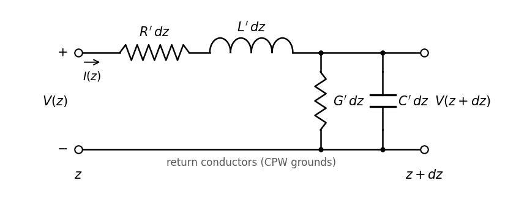
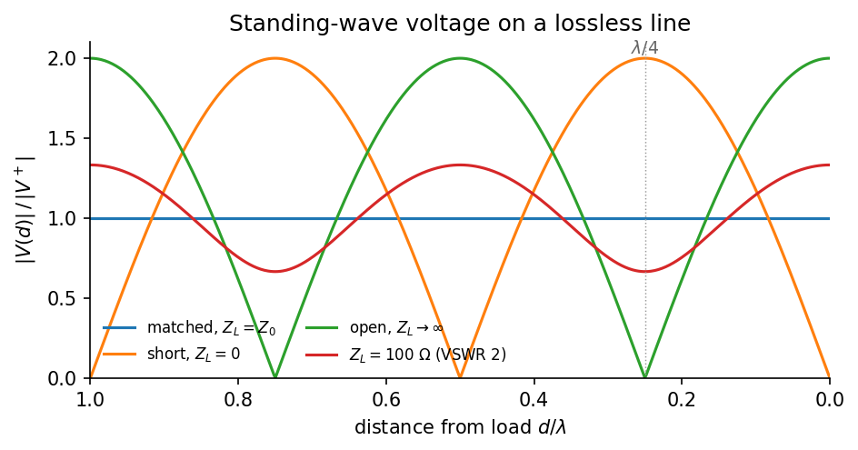
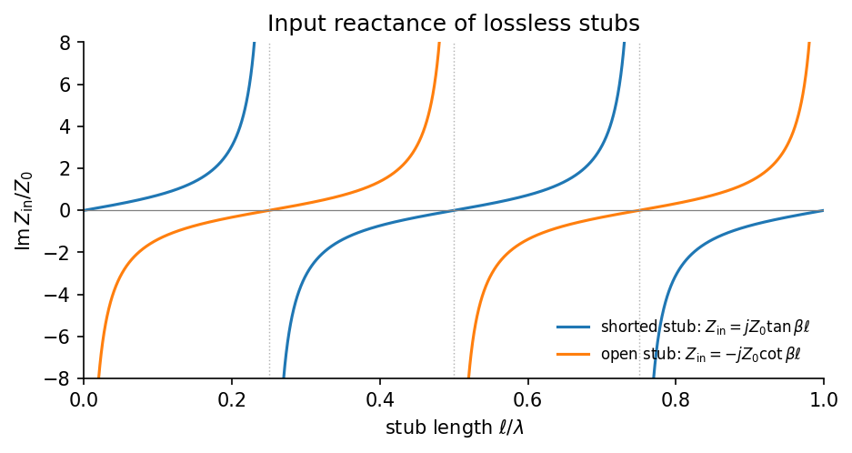

# CPW Transmission Line Theory

**Part 2 of 3** · [← Previous: CPW Fundamentals](01_cpw_fundamentals.md) · [Project overview](../README.md) · Next: [CPW Resonators →](03_cpw_resonators.md)

## Introduction to the transmission-line model

A CPW is a *distributed* structure. A voltage or current disturbance does not appear everywhere along it at once; it travels at a finite speed. A lumped circuit model ignores this travel time, which is a good approximation only when the circuit is much smaller than the wavelength. A 6 GHz CPW resonator on silicon is about 5 mm long, a quarter of the guided wavelength, so the travel time matters and the line must be treated as distributed.

When the cross-section and materials are uniform along the line and the dominant mode is quasi-TEM (see [CPW Fundamentals](01_cpw_fundamentals.md)), the three-dimensional field problem reduces to a one-dimensional **transmission-line model**. This model captures propagation, reflection, and power flow while keeping the finite travel time.

Let $z$ be the position along the line, increasing from source toward load, and $t$ be time. The line voltage $V(z,t)$ is the potential of the center conductor relative to the grounds at position $z$. The line current $I(z,t)$ is the current on the center conductor in the $+z$ direction; the total return current on the grounds is equal and opposite. In a symmetric CPW mode it divides equally between the two grounds, but that split need not hold for asymmetric geometry or excitation.

## Distributed circuit parameters

A short segment of line, of length $dz$, is modeled by a series impedance and a shunt admittance built from four parameters per unit length:

| Parameter | Physical origin | SI units |
|---|---|---|
| $R'$ | Series resistance of the signal and return paths (conductor loss) | Ω/m |
| $L'$ | Series inductance: magnetic-field energy, plus kinetic inductance in superconductors | H/m |
| $G'$ | Shunt conductance: dielectric loss and leakage | S/m |
| $C'$ | Shunt capacitance between signal and grounds: electric-field energy | F/m |

*Figure 1. Equivalent circuit of a segment of length $dz$. A long line is a cascade of many such segments in the limit $dz \to 0$.*

The prime marks a quantity per unit length; it is not a derivative. $L'$ and $C'$ describe energy *storage* (magnetic and electric); $R'$ and $G'$ describe energy *dissipation*.

For an ideal lossless line, $R' = G' = 0$. Real lines are lossy, and their parameters can depend on frequency. Skin and proximity effects redistribute current in normal metals; in superconductors, the surface impedance and kinetic inductance depend on frequency, temperature, and film quality. For a low-loss dielectric, shunt loss is often written as

$$
G' \approx \omega C' \tan\delta ,
$$

where $\tan\delta$ is the dielectric loss tangent. In a CPW, the field occupies several dielectric regions (substrate, vacuum, thin surface layers), so the effective $\tan\delta$ is a participation-weighted average of each region's loss tangent, not a property of the substrate alone.

## Telegrapher's equations

Apply Kirchhoff's laws to the segment in Figure 1. The voltage drop across the series elements is

$$
V(z,t) - V(z+dz,t) = R'\,dz\,I(z,t) + L'\,dz\,\frac{\partial I(z,t)}{\partial t},
$$

and the current lost through the shunt elements is $G'\,dz\,V + C'\,dz\,\partial V/\partial t$. Dividing by $dz$ and letting $dz \to 0$ gives the **telegrapher's equations**:

$$
\frac{\partial V}{\partial z} = -R' I - L' \frac{\partial I}{\partial t},
\qquad
\frac{\partial I}{\partial z} = -G' V - C' \frac{\partial V}{\partial t}.
$$

The minus signs encode the voltage drop along the series branch and the current drawn by the shunt branch. They do not imply that voltage and current decrease monotonically with position: a standing wave is a superposition of forward and reflected waves.

For sinusoidal signals, use phasors with the engineering convention

$$
v(z,t) = \mathrm{Re}\{V(z)\,e^{j\omega t}\},
\qquad
i(z,t) = \mathrm{Re}\{I(z)\,e^{j\omega t}\},
$$

where $\omega = 2\pi f$. A time derivative becomes multiplication by $j\omega$, so

$$
\frac{dV}{dz} = -(R' + j\omega L')\,I \equiv -Z' I,
\qquad
\frac{dI}{dz} = -(G' + j\omega C')\,V \equiv -Y' V,
$$

with series impedance per length $Z' = R' + j\omega L'$ and shunt admittance per length $Y' = G' + j\omega C'$. Differentiating one equation and substituting the other gives decoupled wave equations:

$$
\frac{d^2 V}{dz^2} = \gamma^2 V,
\qquad
\frac{d^2 I}{dz^2} = \gamma^2 I,
\qquad
\gamma = \sqrt{(R' + j\omega L')(G' + j\omega C')} = \alpha + j\beta .
$$

$\gamma$ is the **propagation constant**. Its real part $\alpha$ is the attenuation constant (Np/m) and its imaginary part $\beta$ is the phase constant (rad/m). The root is chosen with $\alpha \ge 0$ so that a forward wave decays rather than grows in a passive line.

## Characteristic impedance

The general solution is a superposition of forward and backward waves:

$$
V(z) = V^+ e^{-\gamma z} + V^- e^{+\gamma z},
\qquad
I(z) = \frac{1}{Z_0}\left(V^+ e^{-\gamma z} - V^- e^{+\gamma z}\right).
$$

Substituting the forward wave into $dV/dz = -Z' I$ gives the ratio of voltage to current in a single traveling wave, the **characteristic impedance**:

$$
Z_0 \equiv \frac{V^+}{I^+} = \frac{Z'}{\gamma} = \sqrt{\frac{R' + j\omega L'}{G' + j\omega C'}} .
$$

The backward wave has the opposite sign of current ($I^- = -V^-/Z_0$) because it carries power in the $-z$ direction. $Z_0$ is not a resistance that dissipates power. It is the impedance a wave "sees" as it travels, and the impedance an infinitely long (or perfectly terminated) line presents at its input. For a lossless line,

$$
Z_0 = \sqrt{\frac{L'}{C'}} ,
$$

which is real. $Z_0$ measures the balance between magnetic and electric energy storage. Under the lossless model, increasing $L'$ raises $Z_0$ and increasing $C'$ lowers it. Geometry changes generally affect both parameters; for a conventional CPW, a wider center strip relative to the slots often increases $C'$ and lowers $Z_0$, but the trend is conditional on the rest of the cross-section and material stack. For a CPW, $L'$ and $C'$ are set by the cross-section; closed-form conformal-mapping expressions are given in [CPW Fundamentals](01_cpw_fundamentals.md#quasi-static-design-equations).

## Propagation constant and wave velocity

For a forward wave $e^{-\gamma z} = e^{-\alpha z}e^{-j\beta z}$, the amplitude decays as $e^{-\alpha z}$ and the phase factor accumulates as $e^{-j\beta z}$ (a spatial phase lag of $\beta z$ under the stated phasor convention). The phase velocity and guided wavelength are

$$
v_\mathrm{p} = \frac{\omega}{\beta},
\qquad
\lambda = \frac{2\pi}{\beta}.
$$

For a lossless line, $\gamma = j\omega\sqrt{L'C'}$, so

$$
\alpha = 0,
\qquad
\beta = \omega\sqrt{L'C'},
\qquad
v_\mathrm{p} = \frac{1}{\sqrt{L'C'}} .
$$

If $L'$ and $C'$ are frequency independent and the line is lossless, then $v_\mathrm{p}$ is frequency independent and the ideal line is nondispersive, so group and phase velocities are equal. Frequency-dependent parameters or appreciable loss can make phase propagation dispersive; for a lossy line, group velocity also requires careful interpretation.

This connects directly to the effective permittivity of [CPW Fundamentals](01_cpw_fundamentals.md#quasi-tem-propagation): for a nonmagnetic quasi-TEM CPW without appreciable kinetic inductance, $c^2 L'C' \approx \varepsilon_\mathrm{eff}$. If $L'=L_m'+L_k'$ includes kinetic inductance, define $\alpha_k=L_k'/L'$. Relative to the same geometry with only magnetic inductance $L_m'$, and assuming $C'$ is unchanged, the phase velocity is reduced by $\sqrt{L_m'/L'}=\sqrt{1-\alpha_k}$.

**Summary for the reference geometry** ($w = 10$ µm, $s = 6$ µm on silicon, from the worked example in [CPW Fundamentals](01_cpw_fundamentals.md)): $L' \approx 424$ nH/m, $C' \approx 163$ pF/m, $Z_0 \approx 51$ Ω, and $v_\mathrm{p} \approx 0.40\,c$.

## Terminated lines: reflection and input impedance

A line of characteristic impedance $Z_0$ terminated in a load $Z_L$ at $z = 0$ must satisfy $V(0)/I(0) = Z_L$. A single forward wave cannot satisfy this unless $Z_L = Z_0$, so the load generates a reflected wave. The **reflection coefficient** at the load is

$$
\Gamma_L = \frac{V^-}{V^+} = \frac{Z_L - Z_0}{Z_L + Z_0}.
$$

Three limits are important:

| Termination | $\Gamma_L$ | Behavior at the load |
|---|---|---|
| Matched, $Z_L = Z_0$ | 0 | No reflection; all power absorbed |
| Short circuit, $Z_L = 0$ | −1 | Voltage node, current antinode |
| Open circuit, $Z_L \to \infty$ | +1 | Voltage antinode, current node |

The incident and reflected waves interfere to form a **standing wave**. On a lossless line the voltage magnitude at distance $d$ from the load is $|V(d)| = |V^+|\,|1 + \Gamma_L e^{-2j\beta d}|$. This repeats every half wavelength, with maxima and minima a quarter wavelength apart.

*Figure 2. Voltage magnitude along a lossless line for several terminations. A short forces a voltage node at the load; one quarter wavelength away the voltage is maximal, so the short looks like an open circuit there.*

Seen from a distance $\ell$ in front of the load, the line plus load presents an **input impedance**

$$
Z_\mathrm{in}(\ell) = Z_0\,\frac{Z_L + Z_0\tanh\gamma\ell}{Z_0 + Z_L\tanh\gamma\ell}
\;\xrightarrow{\ \text{lossless}\ }\;
Z_0\,\frac{Z_L + jZ_0\tan\beta\ell}{Z_0 + jZ_L\tan\beta\ell}.
$$

For electrically short or open-circuited sections ("stubs") of a lossless line, this reduces to

$$
Z_\mathrm{in}^\mathrm{short} = jZ_0\tan\beta\ell,
\qquad
Z_\mathrm{in}^\mathrm{open} = -jZ_0\cot\beta\ell .
$$

*Figure 3. Input reactance of lossless shorted and open stubs. A shorted stub behaves like an inductor when short and its reactance diverges at $\ell = \lambda/4$. An open stub behaves like a capacitor when short, passes through zero at $\ell = \lambda/4$, and diverges at $\ell = \lambda/2$.*

The poles of these input impedances are the key result for this project. A quarter-wavelength section shorted at one end ($\beta\ell = \pi/2$) presents an open circuit at its other end, and so does a half-wavelength section that is itself open at the far end ($\beta\ell = \pi$). Near an impedance pole, the terminal response can be approximated by that of a parallel *LC* circuit over a sufficiently narrow frequency range. These are the **quarter-wave** and **half-wave resonators**, analyzed in [CPW Resonators](03_cpw_resonators.md). Two related tools follow from the same equations:

- **Quarter-wave transformer.** For $\beta\ell = \pi/2$, $Z_\mathrm{in} = Z_0^2/Z_L$. A quarter-wave section with $Z_0 = \sqrt{Z_1 Z_2}$ matches two impedances at one frequency.
- **Short stubs as lumped elements.** For $\beta\ell \ll 1$, a shorted stub is approximately an inductor, $L \approx L'\ell$, while an open stub is approximately a capacitor, $C \approx C'\ell$. This is one way to realize compact on-chip reactances.

## Loss and quality factor

For a low-loss line ($R' \ll \omega L'$ and $G' \ll \omega C'$), expanding $\gamma$ to first order gives

$$
\alpha \approx \underbrace{\frac{R'}{2Z_0}}_{\alpha_c} + \underbrace{\frac{G' Z_0}{2}}_{\alpha_d},
\qquad
Z_0 = \sqrt{L'/C'} ,
$$

with conductor and dielectric contributions $\alpha_c$ and $\alpha_d$. For resonators it is more natural to express loss as a quality factor. A resonator built from a low-loss line, with no other loss channels, has

$$
Q_i \approx \frac{\beta}{2\alpha},
\qquad\text{and for dielectric loss,}\qquad
\frac{1}{Q_d} = \tan\delta_\mathrm{eff} = \sum_i p_i\tan\delta_i.
$$

As an illustration, if the effective, participation-weighted dielectric loss tangent is $10^{-6}$, the dielectric-limited quality factor is $Q_d=10^6$. This is an example value, not a universal property of silicon CPWs. This connection between distributed attenuation and resonator $Q$ is what makes CPW resonators sensitive probes of material loss.

The physical origins of $R'$ and $G'$ in a superconducting CPW (two-level systems, quasiparticles, vortices, radiation) are discussed in [CPW Fundamentals](01_cpw_fundamentals.md#loss-channels).

## Practical design interpretation

The RLGC parameters summarize how a given cross-section stores and dissipates energy. Geometry (center width, gap, thickness, ground extent) sets $L'$ and $C'$ through the field distribution, and with it $Z_0$ and $v_\mathrm{p}$. Materials set $R'$ (through the surface impedance), $G'$ (through the participation-weighted loss tangents), and the kinetic part of $L'$. These quantities are coupled: changing the geometry moves both electric and magnetic fields, so no single dimension controls impedance or loss independently.

The RLGC model assumes a uniform line. Where that breaks down (bends, couplers, finite grounds, packages), full-wave simulation is often appropriate; see [Limitations of the simplified picture](01_cpw_fundamentals.md#limitations-of-the-simplified-picture).

## References

1. D. M. Pozar, *Microwave Engineering*, 4th ed. (John Wiley & Sons, 2011), Chapters 2 (transmission-line theory) and 3 (transmission lines and waveguides). [Wiley publisher page](https://www.wiley.com/en-us/Microwave+Engineering%2C+4th+Edition-p-9780470631553)
2. R. N. Simons, *Coplanar Waveguide Circuits, Components, and Systems* (John Wiley & Sons, 2001). [https://doi.org/10.1002/0471224758](https://doi.org/10.1002/0471224758)
3. G. Ghione and C. U. Naldi, "Coplanar waveguides for MMIC applications: effect of upper shielding, conductor backing, finite-extent ground planes, and line-to-line coupling," *IEEE Transactions on Microwave Theory and Techniques* **35**, 260–267 (1987). [https://doi.org/10.1109/TMTT.1987.1133637](https://doi.org/10.1109/TMTT.1987.1133637)
4. J. Gao, *The Physics of Superconducting Microwave Resonators*, Ph.D. thesis, California Institute of Technology (2008). [https://doi.org/10.7907/RAT0-VM75](https://doi.org/10.7907/RAT0-VM75)
5. W. Woods et al., "Determining interface dielectric losses in superconducting coplanar-waveguide resonators," *Physical Review Applied* **12**, 014012 (2019). [https://doi.org/10.1103/PhysRevApplied.12.014012](https://doi.org/10.1103/PhysRevApplied.12.014012)

---

**Part 2 of 3** · [← Previous: CPW Fundamentals](01_cpw_fundamentals.md) · [Project overview](../README.md) · Next: [CPW Resonators →](03_cpw_resonators.md)
