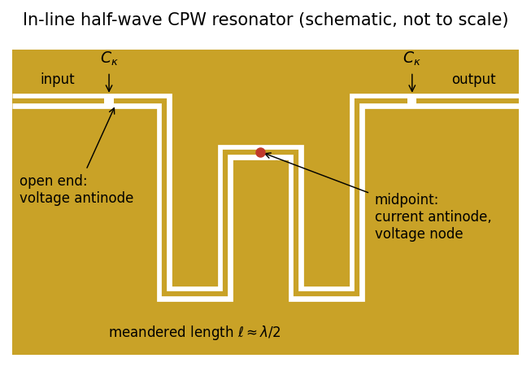
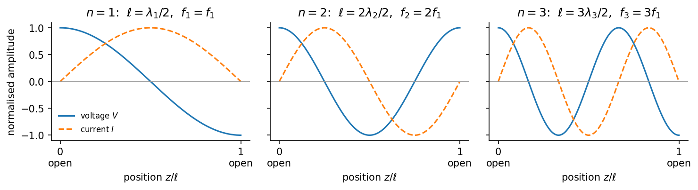
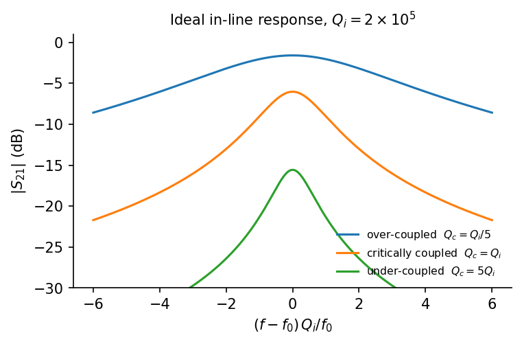
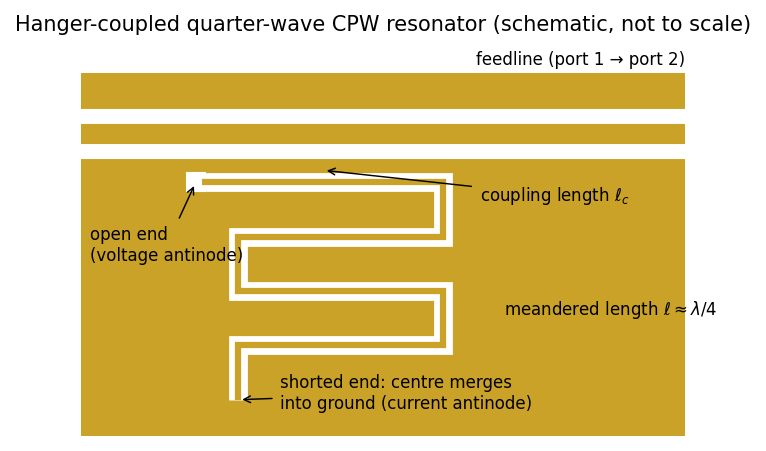
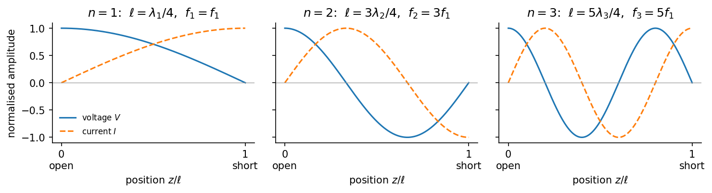
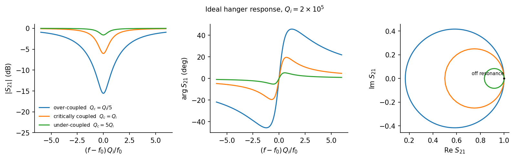

# CPW Resonators: Half-Wave and Quarter-Wave

**Part 3 of 3** · [← Previous: Transmission Line Theory](02_transmission_line_theory.md) · [Project overview](../README.md)

## Operating Principle

A transmission-line resonator is a section of CPW of length $\ell$ terminated at both ends by strong reflections. A wave travelling along the section bounces back and forth between the ends. At certain frequencies the round-trip phase makes the reflections add constructively, and energy builds up in a standing wave. Those frequencies are the resonances.

In practice, the terminations are an **open circuit**, where the center conductor ends at a gap, or a **short circuit**, where the center conductor merges into the ground plane. They impose opposite boundary conditions:

| Termination | Reflection coefficient | Voltage | Current | Dominant stored energy |
|---|---|---|---|---|
| Open end | $\Gamma = +1$ | antinode (maximum) | node (zero) | electric (capacitive) |
| Shorted end | $\Gamma = -1$ | node (zero) | antinode (maximum) | magnetic (inductive) |

A wave that makes one round trip along the resonator picks up a phase $2\beta\ell$ from propagation and is multiplied by the two end reflection coefficients $\Gamma_1$ and $\Gamma_2$. Resonance requires it to return in phase with itself:

$$
\Gamma_1\Gamma_2\,e^{-2j\beta\ell} = 1 .
$$

Combining two terminations gives the two families of CPW resonators used in superconducting circuits:

- **[Half-wave ($\lambda/2$) resonators](#half-wave-resonators)** have the *same* termination at both ends, so $\Gamma_1\Gamma_2 = +1$.
- **[Quarter-wave ($\lambda/4$) resonators](#quarter-wave-resonators)** have one open and one shorted end, so $\Gamma_1\Gamma_2 = -1$.

Both are workhorses of circuit quantum electrodynamics (circuit QED) [6]. They serve as qubit readout resonators, quantum buses between qubits, Purcell filters, and test structures for measuring material loss [3]. A qubit is coupled capacitively near a voltage antinode or inductively near a current antinode, so knowing where these antinodes sit is part of the design.

### Lumped-element equivalent

Near a single resonance $\omega_n$, either resonator, seen from a voltage antinode (an open end), behaves like a parallel *RLC* circuit [1, 6]:

$$
C = \frac{C'\ell}{2},
\qquad
L_n = \frac{1}{\omega_n^2 C},
\qquad
R = \frac{Z_0}{\alpha\ell}.
$$

The equivalent capacitance is half the total line capacitance for every mode and both types, because the voltage varies sinusoidally along the line and its mean square is half the peak value. The equivalent circuit is the standard interface to circuit-QED models: each mode is a harmonic oscillator with $\omega_n = 1/\sqrt{L_n C}$, and couplings to qubits or feedlines follow from $C$ and the coupling capacitances. The explicit values of $C$ and $L$ for each type are given in its own section below.

## Quality Factors and Coupling

A resonator loses energy through internal mechanisms and through its intentional coupling to the measurement circuit. Each loss channel defines a quality factor $Q = \omega_0 \times (\text{stored energy})/(\text{power lost})$:

- **Internal quality factor $Q_i$.** Losses in the resonator itself: dielectric (TLS), conductor, radiation, and others ([CPW Fundamentals](01_cpw_fundamentals.md#loss-channels)). $1/Q_i = \sum_k 1/Q_k$.
- **Coupling (external) quality factor $Q_c$.** Energy leaking out through all coupling ports.
- **Loaded quality factor $Q_l$.** The total, $1/Q_l = 1/Q_i + 1/Q_c$. It sets the linewidth $\kappa/2\pi = f_0/Q_l$.

A small coupling capacitor $C_c$ in series with an external load $R_\mathrm{ext}$ appears across the resonator as a large parallel resistance $\approx 1/(\omega_0^2 C_c^2 R_\mathrm{ext})$. This gives a general result for capacitive coupling at a voltage antinode:

$$
Q_c \approx \frac{C}{\omega_0\,C_c^2\,R_\mathrm{ext}},
$$

where $C$ is the resonator's equivalent capacitance. The external load $R_\mathrm{ext}$ depends on the coupling scheme: in-line for half-wave resonators, hanger for quarter-wave. Because $Q_c \propto 1/C_c^2$, small changes in coupler geometry produce large changes in $Q_c$.

The ratio $Q_c/Q_i$ sets the **coupling regime**:

| Regime | Condition | Typical use |
|---|---|---|
| Over-coupled | $Q_c \ll Q_i$ | Qubit readout: fast response, linewidth set by design ($\kappa \approx \omega_0/Q_c$) |
| Critically coupled | $Q_c = Q_i$ | Maximum power absorbed on resonance |
| Under-coupled | $Q_c \gg Q_i$ | Materials studies: the linewidth reflects internal loss, so $Q_i$ is measured accurately |

Real measurements include cable delay, amplitude and phase background, and impedance mismatch around the coupler. Standard fitting methods account for these and fit the full complex response, not just the magnitude [2, 4].

## Half-Wave Resonators

### Geometry and coupling

A half-wave resonator has the same termination at both ends. The common **open–open** version is a length of CPW whose center conductor is interrupted by a coupling gap at each end. The **short–short** version has both ends grounded and the voltage and current profiles swapped. It is used less often and is not discussed further here.

The natural way to use an open–open resonator is **in-line**: coupling capacitors $C_\kappa$ at the two ends connect it to an input and an output feedline, and the signal is measured in transmission *through* the resonator. This was the original circuit-QED geometry [6].

*Figure 1. Schematic of an in-line half-wave resonator (gold = metal, white = exposed substrate). Gaps in the center conductor form the coupling capacitors $C_\kappa$. Both open ends are voltage antinodes. For the fundamental mode, the midpoint is a current antinode and a voltage node.*

### Resonance condition and mode profiles

Seen from one open end, an open–open line has input impedance $Z_\mathrm{in} = -jZ_0\cot\beta\ell$ ([Transmission Line Theory](02_transmission_line_theory.md#terminated-lines-reflection-and-input-impedance)). This diverges, so the line can sustain a voltage at the end with no current flowing in, when

$$
\beta\ell = n\pi
\qquad\Longleftrightarrow\qquad
\ell = n\,\frac{\lambda_n}{2},
\qquad n = 1, 2, 3, \ldots
$$

Measuring $z$ from one open end, the standing waves of mode $n$ are

$$
V_n(z) \propto \cos\frac{n\pi z}{\ell},
\qquad
I_n(z) \propto \sin\frac{n\pi z}{\ell}.
$$

*Figure 2. Voltage and current standing waves of the first three modes of an open–open half-wave resonator. Every integer harmonic is allowed, and both ends are always voltage antinodes.*

In the fundamental mode, the voltage is maximal and of opposite sign at the two ends, and the current is maximal at the center. Both ends are therefore good places for capacitive coupling, for example to two qubits in a quantum bus, and the center is the place for inductive coupling. The center is also a voltage node for all odd modes, so a DC or low-frequency bias line connected there barely perturbs the fundamental.

### Resonant frequency and equivalent circuit

$$
f_n = n\,\frac{v_\mathrm{p}}{2\ell} = n\,\frac{c}{2\ell\sqrt{\varepsilon_\mathrm{eff}}},
\qquad
f_0 \equiv f_1 = \frac{v_\mathrm{p}}{2\ell}.
$$

The spectrum contains every harmonic, $f_0, 2f_0, 3f_0, \ldots$ For the fundamental, the general equivalent circuit gives

$$
C = \frac{\pi}{2\omega_0 Z_0},
\qquad
L = \frac{2Z_0}{\pi\omega_0},
\qquad
\sqrt{L/C} = \frac{2}{\pi}Z_0 .
$$

### In-line coupling and transmission response

With symmetric couplers $C_\kappa$ at each end, each port loads the resonator with $R_\mathrm{ext} = Z_\mathrm{f}$, the feedline impedance. The two ports add, giving

$$
Q_c = \frac{C}{2\omega_0 C_\kappa^2 Z_\mathrm{f}} = \frac{\pi}{4\omega_0^2 C_\kappa^2 Z_\mathrm{f} Z_0}.
$$

Away from resonance, the small coupling capacitors block transmission. Near resonance, the resonator carries the signal from input to output, giving a Lorentzian **peak** in $S_{21}$:

$$
S_{21} = \frac{Q_l/Q_c}{1 + 2jQ_l\,\dfrac{f - f_0}{f_0}} .
$$

On resonance, the transmission is $Q_l/Q_c = Q_i/(Q_i + Q_c)$. For unequal input and output couplers, the peak becomes $2Q_l/\sqrt{Q_{c,1}Q_{c,2}}$, where $Q_{c,1}$ and $Q_{c,2}$ are the coupling quality factors of the two ports.

*Figure 3. Ideal in-line transmission peak for three coupling regimes at fixed $Q_i$. Over-coupled resonators transmit almost fully on resonance; under-coupled resonators show a weak, narrow peak.*

Gap capacitors give only a few femtofarads. When stronger coupling is needed, as for fast readout, interdigitated (finger) capacitors are used instead. A half-wave resonator can also be **hanger-coupled** through one end to a through feedline, as described for quarter-wave resonators below. That arrangement is used when several half-wave resonators share a feedline.

## Quarter-Wave Resonators

### Geometry and coupling

A quarter-wave resonator is a length of CPW with one **open** end and one **shorted** end, where the center conductor merges into the ground plane. The shortest line that satisfies a voltage antinode at one end and a voltage node at the other is a quarter wavelength long. This is half the length of a half-wave resonator at the same frequency, which is the main reason quarter-wave resonators are popular for frequency-multiplexed readout, where many resonators share one chip.

The natural way to use a quarter-wave resonator is as a **hanger**: the open end runs alongside a through feedline, and the resonator removes power from the feedline at resonance.

*Figure 4. Schematic of a hanger-coupled quarter-wave resonator. The open end runs alongside the feedline over a coupling length $\ell_c$, where the high voltage gives capacitive coupling. The line is meandered to save area, and its center conductor merges into the ground plane at the shorted end.*

### Resonance condition and mode profiles

Seen from the open end, a line shorted at its far end has input impedance $Z_\mathrm{in} = jZ_0\tan\beta\ell$ ([Transmission Line Theory](02_transmission_line_theory.md#terminated-lines-reflection-and-input-impedance)). This diverges when

$$
\beta\ell = (2n - 1)\,\frac{\pi}{2}
\qquad\Longleftrightarrow\qquad
\ell = (2n - 1)\,\frac{\lambda_n}{4},
\qquad n = 1, 2, 3, \ldots
$$

Measuring $z$ from the open end, the standing waves of mode $n$ are

$$
V_n(z) \propto \cos\frac{(2n-1)\pi z}{2\ell},
\qquad
I_n(z) \propto \sin\frac{(2n-1)\pi z}{2\ell}.
$$

*Figure 5. Voltage and current standing waves of the first three modes of a quarter-wave resonator. Every mode has a voltage antinode at the open end and a voltage node at the short, so only odd harmonics exist.*

The voltage antinode is always at the open end and the current antinode at the shorted end, so each coupling type has one natural location: capacitive coupling to a qubit or feedline at the open end, and inductive coupling at the shorted end.

### Resonant frequency and equivalent circuit

$$
f_n = (2n - 1)\,\frac{v_\mathrm{p}}{4\ell} = (2n - 1)\,\frac{c}{4\ell\sqrt{\varepsilon_\mathrm{eff}}},
\qquad
f_0 \equiv f_1 = \frac{v_\mathrm{p}}{4\ell}.
$$

The spectrum contains only odd harmonics, $f_0, 3f_0, 5f_0, \ldots$ For the fundamental,

$$
C = \frac{\pi}{4\omega_0 Z_0},
\qquad
L = \frac{4Z_0}{\pi\omega_0},
\qquad
\sqrt{L/C} = \frac{4}{\pi}Z_0 .
$$

At the same frequency, a quarter-wave resonator has half the equivalent capacitance and twice the equivalent inductance of a half-wave resonator. It is therefore more strongly affected by a given coupling capacitance: the coupling is larger and so is the frequency pull.

### Hanger coupling and notch response

In a hanger, the coupler sees the feedline continuing in both directions, so $R_\mathrm{ext} = Z_\mathrm{f}/2$, giving

$$
Q_c = \frac{2C}{\omega_0 C_c^2 Z_\mathrm{f}} = \frac{\pi}{2\omega_0^2 C_c^2 Z_\mathrm{f} Z_0}.
$$

Elbow couplers like the one in Figure 4 are distributed and also have an inductive component, so in practice $Q_c$ is extracted from simulation. Inductive coupling at the shorted end is an alternative, often used for qubit readout and Purcell filters.

Away from resonance the feedline transmits fully. Near resonance the resonator absorbs and re-radiates power out of phase, giving a **dip** in $S_{21}$:

$$
S_{21} = 1 - \frac{Q_l/Q_c}{1 + 2jQ_l\,\dfrac{f - f_0}{f_0}} .
$$

On resonance $S_{21}(f_0) = Q_l/Q_i$, so the dip depth shows the coupling regime directly. In the complex plane, $S_{21}$ traces a circle of diameter $Q_l/Q_c$ that touches the off-resonance point $(1, 0)$. Impedance mismatch around the coupler makes the resonance asymmetric, which fitting methods model with a complex $Q_c$, equivalent to rotating the circle [2, 4].

*Figure 6. Ideal hanger transmission for three coupling regimes at fixed $Q_i$: magnitude (left), phase (center), and the resonance circle in the complex plane (right). Over-coupled resonators give deep, wide dips; under-coupled resonators give shallow dips whose width approaches $f_0/Q_i$.*

Because each hanger resonator only notches out a narrow band, many quarter-wave resonators at different frequencies can share one feedline. This is the basis of frequency-multiplexed qubit readout and of high-throughput materials-loss measurements.

## Effects Common to Both Types

### Frequency shifts from loading and kinetic inductance

The bare frequency formulas are a starting point. Several effects shift the actual frequency:

- **Coupling capacitance.** A capacitance $C_c$ at an open end adds to $C$, lowering the frequency by $\delta f/f_0 \approx -C_c/(2C)$. An in-line half-wave resonator has a coupling capacitor at each end, so both contribute.
- **Open-end fringing.** Fringing fields at an open end act as a small extra length, typically micrometers to tens of micrometers, depending on the gap.
- **Kinetic inductance.** With kinetic-inductance fraction $\alpha_k = L_k'/(L_m' + L_k')$, the frequency drops to $f_0\sqrt{1 - \alpha_k}$. Since $L_k$ depends on temperature, so does this shift.
- **Bends and meanders.** The effective length is close to the centerline length, but closely spaced turns couple to each other and shift the frequency slightly.
- **Two-level systems.** A weak, temperature-dependent frequency shift is a standard signature of TLS loss [3, 5].

In practice the final length is tuned with electromagnetic simulation, and systematic offsets are calibrated from measurements of earlier devices.

### Electrical length

The **electrical length** is the phase a wave accumulates along the resonator:

$$
\theta = \beta\ell = \frac{2\pi\ell}{\lambda} = \frac{\omega\ell}{v_\mathrm{p}} .
$$

At the fundamental, $\theta = \pi$ (180°) for a half-wave resonator and $\theta = \pi/2$ (90°) for a quarter-wave resonator. In both cases $\theta$ scales linearly with frequency, so a small length change $\delta\ell$ shifts the frequency by

$$
\frac{\delta f}{f_0} = -\frac{\delta\ell}{\ell}.
$$

The *fractional* sensitivity is the same for both types. In absolute terms, a 1 MHz step at 6 GHz corresponds to $\delta\ell \approx 1.7$ µm for a 10 mm half-wave resonator and $\approx 0.8$ µm for a 5 mm quarter-wave resonator. Two practical consequences:

- Resonators on a shared feedline can be spaced tens of MHz apart with length differences of only tens of micrometers.
- Variations in $\varepsilon_\mathrm{eff}$ or kinetic inductance at the 0.1 % level shift frequencies by several MHz. Absolute frequency targeting is therefore harder than controlling relative spacing.

## Choosing Between Half-Wave and Quarter-Wave

| Consideration | Half-wave | Quarter-wave |
|---|---|---|
| Length at a given $f_0$ | $\lambda/2$ (10.0 mm at 6 GHz on Si) | $\lambda/4$ (5.0 mm), half the area |
| Spectrum | all harmonics: $f_0, 2f_0, 3f_0, \ldots$ | odd harmonics only: $f_0, 3f_0, 5f_0, \ldots$ |
| Voltage antinodes (fundamental) | both ends | open end |
| Current antinode (fundamental) | center | shorted end |
| Natural coupling scheme | in-line, coupled at both ends; hanger also possible | hanger |
| Frequency multiplexing | in-line: one resonator per line; hanger: many per feedline | many per feedline |
| DC path to ground | none for open–open (center conductor floats) | through the shorted end |
| Fabrication | no galvanic short needed; ends defined by gaps only | requires a clean short to ground |

A **half-wave** resonator is the natural choice for an in-line transmission measurement, for a quantum bus with qubits at the two voltage antinodes, or when a DC-isolated center conductor is needed.

A **quarter-wave** resonator is the natural choice when chip area matters and many resonators share one feedline, as in multiplexed qubit readout. Its sparser spectrum keeps the first higher mode at $3f_0$, far from the operating band.

## Design Considerations

### Worked design example

Target: a 6.0 GHz resonator on high-resistivity silicon, using the 50 Ω geometry from [CPW Fundamentals](01_cpw_fundamentals.md) ($w = 10$ µm, $s = 6$ µm, $\varepsilon_\mathrm{eff} \approx 6.23$, $v_\mathrm{p} \approx 1.20\times10^8$ m/s, $C' \approx 163$ pF/m), coupled to a $Z_\mathrm{f} = 50$ Ω feedline.

| Quantity | Half-wave | Quarter-wave |
|---|---|---|
| Length $\ell$ | 10.01 mm | 5.01 mm |
| Equivalent capacitance $C = C'\ell/2$ | 818 fF | 409 fF |
| Equivalent inductance $L$ | 0.86 nH | 1.72 nH |
| Hanger $C_c$ for $Q_c = 10^4$ (readout) | 9.3 fF | 6.6 fF |
| Hanger $C_c$ for $Q_c = 10^5$ (materials) | 3.0 fF | 2.1 fF |
| In-line $C_\kappa$ at each end for $Q_c = 10^4$ | 4.7 fF | — |
| In-line $C_\kappa$ at each end for $Q_c = 10^5$ | 1.5 fF | — |
| Frequency pull from 2.1 fF at an open end | ≈ −7.6 MHz | ≈ −15 MHz |
| Frequency with 2 % kinetic inductance | 5.94 GHz | 5.94 GHz |

All numbers are reproduced by [`scripts/generate_doc_figures.py`](../scripts/generate_doc_figures.py). The few-femtofarad coupling capacitances explain why hanger couplers are usually distributed elbows running alongside the feedline, and why in-line resonators switch from gap to finger capacitors when strong coupling is needed.

### Layout and fabrication

- **Footprint.** Resonators of several millimeters are meandered to fit on the chip. Keep adjacent meander segments at least a few times $w + 2s$ apart to limit self-coupling, and use rounded bends to avoid current crowding at corners.
- **Ground continuity.** Place air bridges or crossovers across the resonator, especially near bends, to suppress the slotline mode, and bond the ground plane densely to the package.
- **Frequency planning.** Space multiplexed resonators on a shared feedline tens of MHz apart, with spacing chosen against expected fabrication scatter. Keep harmonics ($2f_0$ for half-wave, $3f_0$ for quarter-wave) and package box modes away from the operating bands of other circuit elements.
- **Flux trapping.** Vortices trapped in the film near the resonator cause loss. Magnetic shielding, slow cooldowns, and arrays of small holes in the ground plane reduce their impact.

### Loss and power

- **Geometry and surface loss.** A wider $w$ and $s$ at the same $Z_0$ reduce surface participation, and so TLS loss, at the cost of area and stronger coupling to box modes. This holds for both resonator types.
- **Power dependence.** TLS loss saturates at high field, so $Q_i$ is typically reported both at the single-photon level (relevant for qubits) and at high power. The average photon number in a resonator driven with input power $P_\mathrm{in}$ at the feedline is [7]

  $$
  \langle n \rangle = \frac{2 Q_l^2}{Q_c}\,\frac{P_\mathrm{in}}{\hbar\omega_0^2},
  $$

  where $Q_c$ is the total coupling quality factor. The formula applies to a hanger and to a symmetric in-line resonator driven from one port. For $f_0 = 6$ GHz, $Q_l = 10^5$, and $Q_c = 2\times10^5$, an input power of −140 dBm at the chip gives $\langle n \rangle \approx 7$.
- **Temperature.** Measurements are normally done well below $T_c/10$ to suppress thermal quasiparticles. The temperature dependence of $f_0$ and $Q_i$ helps separate TLS loss from quasiparticle loss.

### From analytical design to simulation

The analytical model in this project is used to choose the resonator type, cross-section, length, and coupler target. A typical workflow:

1. Choose the resonator type (half-wave or quarter-wave) and coupling scheme for the application.
2. Choose $w$ and $s$ for the target $Z_0$ and loss budget ([CPW Fundamentals](01_cpw_fundamentals.md)).
3. Compute $\ell$ for the target $f_0$, and the $C_c$ needed for the target $Q_c$.
4. Draw the layout (meander, couplers, terminations), then simulate it to extract $f_0$ and $Q_c$, and adjust length and couplers.
5. Check sensitivity to fabrication tolerances, kinetic inductance, harmonics, and package modes.
6. Compare against measurement and feed systematic offsets back into the next design.

## References

1. D. M. Pozar, *Microwave Engineering*, 4th ed. (John Wiley & Sons, 2011), Chapter 6 (microwave resonators). [Wiley publisher page](https://www.wiley.com/en-us/Microwave+Engineering%2C+4th+Edition-p-9780470631553)
2. S. Probst, F. B. Song, P. A. Bushev, A. V. Ustinov, and M. Weides, "Efficient and robust analysis of complex scattering data under noise in microwave resonators," *Review of Scientific Instruments* **86**, 024706 (2015). [https://doi.org/10.1063/1.4907935](https://doi.org/10.1063/1.4907935)
3. C. R. H. McRae, H. Wang, J. Gao, M. R. Vissers, T. Brecht, A. Dunsworth, D. P. Pappas, and J. Mutus, "Materials loss measurements using superconducting microwave resonators," *Review of Scientific Instruments* **91**, 091101 (2020). [https://doi.org/10.1063/5.0017378](https://doi.org/10.1063/5.0017378)
4. M. S. Khalil, M. J. A. Stoutimore, F. C. Wellstood, and K. D. Osborn, "An analysis method for asymmetric resonator transmission applied to superconducting devices," *Journal of Applied Physics* **111**, 054510 (2012). [https://doi.org/10.1063/1.3692073](https://doi.org/10.1063/1.3692073)
5. J. Gao, *The Physics of Superconducting Microwave Resonators*, Ph.D. thesis, California Institute of Technology (2008). [https://doi.org/10.7907/RAT0-VM75](https://doi.org/10.7907/RAT0-VM75)
6. M. Göppl, A. Fragner, M. Baur, R. Bianchetti, S. Filipp, J. M. Fink, P. J. Leek, G. Puebla, L. Steffen, and A. Wallraff, "Coplanar waveguide resonators for circuit quantum electrodynamics," *Journal of Applied Physics* **104**, 113904 (2008). [https://doi.org/10.1063/1.3010859](https://doi.org/10.1063/1.3010859)
7. A. Bruno, G. de Lange, S. Asaad, K. L. van der Enden, N. K. Langford, and L. DiCarlo, "Reducing intrinsic loss in superconducting resonators by surface treatment and deep etching of silicon substrates," *Applied Physics Letters* **106**, 182601 (2015). [https://doi.org/10.1063/1.4919761](https://doi.org/10.1063/1.4919761)

---

**Part 3 of 3** · [← Previous: Transmission Line Theory](02_transmission_line_theory.md) · [Project overview](../README.md)
