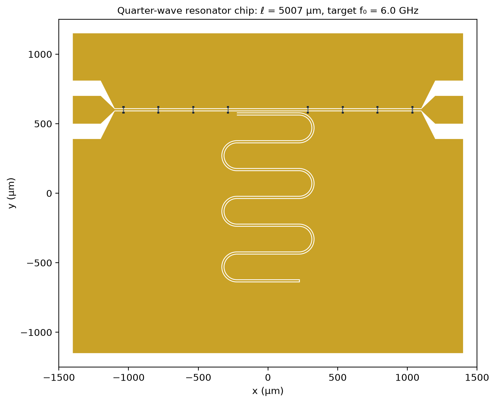

# Layout: Inductively Coupled Quarter-Wave Resonator

Parametric GDS layout of a 6 GHz quarter-wave CPW resonator inductively coupled to a 50 Ω feedline, built with [gdsfactory](https://gdsfactory.github.io/gdsfactory/) and the [QPDK](https://pypi.org/project/qpdk/) superconducting-quantum design kit.



*Gold is metal, white is etched substrate, and the dark marks on the feedline are air bridges. The feedline runs between two launcher pads. The resonator's shorted end runs alongside the feedline, and its open end is at the bottom of the meander.*

## Design

All dimensions come from [`parameters.py`](parameters.py). The resonator length is computed from the analytical CPW model in [CPW Fundamentals](../docs/01_cpw_fundamentals.md), not typed in by hand.

| Parameter | Value | Notes |
|---|---|---|
| Substrate | Si, $\varepsilon_r = 11.45$, 500 µm | high-resistivity silicon at millikelvin temperature |
| CPW center width / gap | 10 µm / 6 µm | $Z_0 \approx 50.9$ Ω, $\varepsilon_\mathrm{eff} \approx 6.23$ |
| Target frequency | 6.0 GHz | |
| Resonator length | 5006.7 µm | $\ell = v_\mathrm{p}/(4f_0)$ |
| Meander | 6 bends, 100 µm radius | 7 straight sections of 446 µm |
| Coupling | inductive, 446 µm long | the shorted end, a current antinode, starts the first straight section, which runs alongside the feedline |
| Coupling gap | 20 µm | center conductor to center conductor, edge to edge; leaves an 8 µm ground strip |
| Feedline air bridges | every 250 µm, 8 in total | none on the coupling section; the closest is 64 µm from the coupler |
| Chip | 3.0 × 2.5 mm | with a 100 µm etched edge frame |

**Why inductive coupling.** The shorted end of a quarter-wave resonator carries the maximum current, so placing it next to the feedline couples the two mainly through their mutual inductance across the shared ground strip ([CPW Resonators](../docs/03_cpw_resonators.md)). The voltage there is close to zero, so the resonator's open end, with its strong electric field, sits away from the feedline. The coupling strength is set by the coupling length and the coupling gap.

**Why air bridges.** The feedline's center conductor separates its two ground planes. Without connections between them, the grounds can sit at different potentials and carry the unwanted slotline mode. The air bridges tie the two grounds together at regular intervals.

The analytical length ignores the frequency pull from the coupler, the open-end fringing field, and kinetic inductance ([CPW Resonators](../docs/03_cpw_resonators.md)). The electromagnetic simulation will measure how far the actual resonance lands from 6.0 GHz, and the length will then be corrected here.

## Layers (QPDK)

| Layer | Content |
|---|---|
| `M1_ETCH` | etched regions: CPW gaps, open-end cap, launcher gaps, chip edge frame |
| `M1_DRAW` | metal drawing of the center conductors |
| `AB_DRAW` | air-bridge spans, the suspended metal crossing the feedline |
| `AB_VIA` | air-bridge landing pads on the ground planes |
| `WG` | waveguide centerlines (reference only) |

Fabrication uses `M1_ETCH`. The simulation derives the metal as the chip area minus `M1_ETCH`.

## Usage

The scripts use the shared design environment (gdsfactory 9.51, QPDK 0.4.1; versions pinned in [`requirements.txt`](../../requirements.txt)):

```bash
qdesign                                                # activate the environment
python cpw-resonator-design/layout/parameters.py       # print the design summary
python cpw-resonator-design/layout/make_layout.py      # write the .gds and .png
```

Open `quarter_wave_resonator.gds` in [KLayout](https://www.klayout.de) to inspect it.

## Files

| File | Purpose |
|---|---|
| `parameters.py` | design parameters and analytical CPW model |
| `make_layout.py` | builds the chip from QPDK cells and writes the outputs |
| `quarter_wave_resonator.gds` | the layout |
| `quarter_wave_resonator.png` | preview image |
